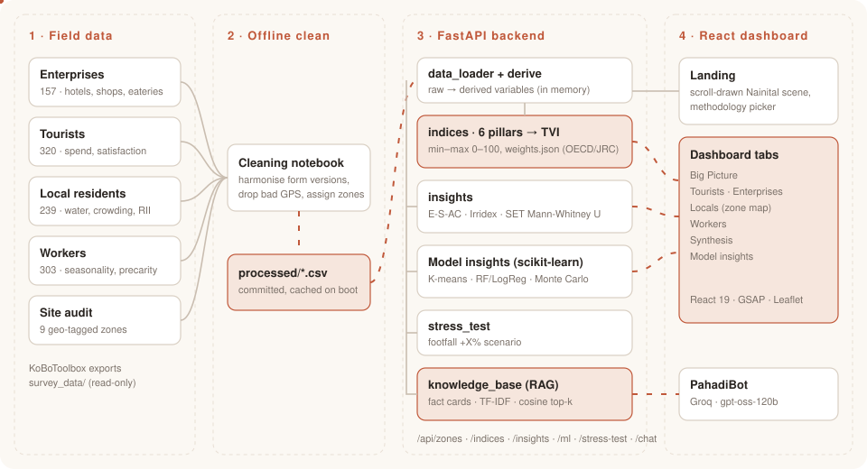
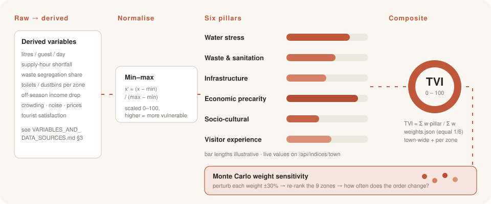
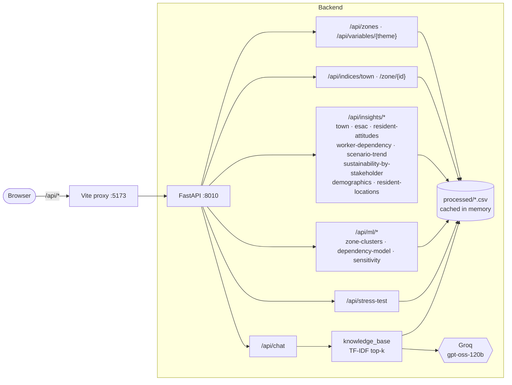
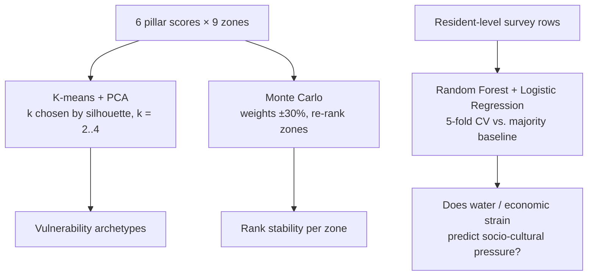
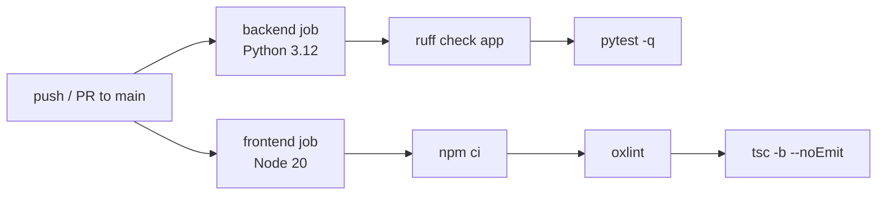

# Nainital Tourism Vulnerability Dashboard

A dashboard that turns field-survey data from Nainital, Uttarakhand into a **Tourism Vulnerability
Index** and an interactive **peak-season stress/pressure test**, so overtourism pressure on water,
waste/sanitation, infrastructure, local livelihoods, and the host community becomes visible and
explorable, not just anecdotal.

<p align="center">
  
</p>

## How it works

The diagrams below are animated SVGs (they respect `prefers-reduced-motion`). The Mermaid
maps further down are rendered by GitHub with pan/zoom controls — hover a diagram and use the
toolbar to explore it.

### 1. From survey row to index

<p align="center">
  
</p>

### 2. How PahadiBot answers

<p align="center">
  
</p>

### 3. Request flow (interactive)



### 4. Model Insights — three checks on the composite index



### 5. CI pipeline



## Background

The source data comes from the **Urban Immersion program**, TISS BS Analytics & Sustainability
Studies (2024–28 batch), which ran 5 field surveys in Nainital:

| Survey | Respondents | Captures |
|---|---|---|
| Enterprise | 157 | Hotels, restaurants, shops: water/waste/energy/labour practices |
| Location (site audit) | 9 zones | Physical infrastructure at fixed GPS points across town |
| Tourist | 320 | Visitor experience, spend, satisfaction |
| Local Residents | 239 | Household water/sanitation, livelihood, perceived crowding/noise/price strain |
| Workers | 303 | Tourism-sector employment, income seasonality, precarity |

Raw files live in `survey_data/` (KoBoToolbox exports, labeled).

## What the dashboard shows

- **Tourism Vulnerability Index (TVI)**: a 0-100 composite score, town-wide and per zone, built
  from six pillars: water stress, waste & sanitation pressure, infrastructure adequacy, economic
  dependency/precarity, socio-cultural pressure, and visitor experience.
- **Sustainability Triad**: the six pillars regrouped into the standard Economic/Social/
  Environmental sustainability triad, shown as a Coxcomb (Nightingale rose) chart.
- **Stakeholder Pressure Matrix**: which respondent group (enterprises, residents, workers,
  tourists) feels the most pressure on which pillar.
- **Seasonality Amplification Index & Host-Visitor Perception Gap**: two further indicators built
  from the same data -- an empirical peak-season signal, and a Doxey's-Irridex-banded comparison
  of tourist satisfaction against host-community sentiment.
- **E-S-AC framework**: a second, complementary vulnerability lens, an IPCC-style Exposure /
  Sensitivity / Adaptive Capacity structure, town-wide and per zone.
- **Resident Attitudes & Social Exchange Theory**: does tourism dependence correlate with less
  felt irritation? A real Mann-Whitney U comparison of tourism-dependent vs. non-dependent
  residents across Economic/Social/Environmental attitude pillars.
- **Peak-season stress test**: a "what if tourist footfall rises by X%" simulator that recomputes
  water, waste, and livelihood pressure under a higher-load scenario, with the assumptions shown,
  not hidden. Served by `/api/stress-test`; not currently surfaced as its own dashboard tab.
- **Zone map**: the 9 surveyed sites plotted with per-zone scores, enriched with OpenStreetMap
  points of interest (parking, toilets, dustbins, healthcare) around each site.
- **Methodology** (on the home page's Data & Methodology section, not a dashboard tab): exact
  definition, source components, normalization method, formula, and citations for every indicator
  above, one at a time.
- **Trends** (scenario-trend + stakeholder APIs): a single long report -- top KPIs, a scenario-based intensity trend,
  the six pillars as a bar chart, an Enterprise-vs-Residents sustainability radar, and a dynamic
  variable explorer (pick a pillar, the chart updates).
- **PahadiBot**: the dashboard's AI chat assistant. Ask it about the dashboard's own numbers.
  Grounded via a small retrieval layer (`backend/app/knowledge_base.py`): every computed number
  is rendered as a short factual "card", TF-IDF + cosine similarity ranks cards against the
  question, and only the top-matching ones go into the prompt -- not the whole dashboard stuffed
  into every request.
- **Model Insights** (a Dashboard tab): three independent checks on the composite-index approach
  above -- K-means clustering of the 9 zones into vulnerability archetypes, a cross-validated
  model predicting socio-cultural pressure from water/economic conditions, and a Monte Carlo
  test of how much the TVI ranking would move if the pillar weights were different.

Full variable list (raw / derived / composite) and every external data source (OSM, Open-Meteo,
Census, tourism-department stats, etc.) is in
**[`VARIABLES_AND_DATA_SOURCES.md`](./VARIABLES_AND_DATA_SOURCES.md)**.

Pipeline design, index methodology, stress-test assumptions, the visual-design rules, and the
phased build plan are in **[`workflow.md`](./workflow.md)**.

The established tourism-carrying-capacity/vulnerability research (UNWTO, Sphere, Falkenmark, GSTC,
Doxey's Irridex, OECD/JRC composite-indicator methodology, Nainital's own NGT-directed carrying
capacity assessment, etc.) used to ground the indices, with citations and honest notes on which
numbers are directly applicable vs. context-only, is in
**[`RESEARCH_BENCHMARKS.md`](./RESEARCH_BENCHMARKS.md)**.

The data-cleaning and exploratory analysis notebook (harmonizes KoBo form-versioning artifacts,
drops dead/empty columns, filters bad GPS points, assigns records to zones, and runs first-pass EDA)
is **[`notebooks/01_data_cleaning_eda.ipynb`](./notebooks/01_data_cleaning_eda.ipynb)**; its cleaned
output tables land in `processed/`.

## Tech stack

### Frontend
- React 19 + TypeScript, built with Vite
- React Router (`react-router-dom`)
- GSAP + `@gsap/react` (ScrollTrigger, DrawSVG, MotionPath -- all the scroll animation)
- Leaflet + `react-leaflet` (the resident-location/zone map), tiles from OpenStreetMap
- `react-markdown` + `remark-gfm` (methodology page)
- `oxlint` (linting)

Real photography is processed into duotone art, with a deliberately narrow warm-white/grey/
terracotta palette and no dark mode. See `workflow.md` §9.1 for the full visual-language rules,
and `frontend/README.md` for how the animation layer is organised.

### Backend
- FastAPI + Uvicorn (Python)
- Pandas + NumPy (data pipeline, composite index computation)
- SciPy (Mann-Whitney U tests for the dependency comparisons)
- scikit-learn (K-means + PCA clustering, Random Forest + Logistic Regression, TF-IDF retrieval)
- Pydantic + pydantic-settings (schemas/config)
- httpx (Groq API calls)
- pytest + ruff (testing/linting, dev-only)

The `processed/*.csv` tables are cleaned/harmonized offline (see the notebook above) and cached in
memory on startup, so the live dashboard never re-processes raw Excel files per request.

### AI / LLM
- Groq API, serving `openai/gpt-oss-120b`, for PahadiBot -- a 3-key fallback pool configured in `.env`

### Infra / DevOps
- Vercel (frontend hosting), Render (backend hosting)
- GitHub Actions (CI: tests, lint, typecheck)

## Status

**Data pipeline, backend, and frontend are built and wired to the live API.**

- `notebooks/01_data_cleaning_eda.ipynb`: done, cleaned tables committed in `processed/`.
- `backend/`: FastAPI app loads `processed/*.csv` (`Z02` excluded as a duplicate site, leaving
  9 zones -- `workflow.md` §3), derives every variable in `VARIABLES_AND_DATA_SOURCES.md` §3,
  computes the 6 sub-indices + TVI (town-wide and per-zone), the 4 cross-cutting insights (§4.1),
  the E-S-AC framework and Resident Attitudes/SET group comparison (§4.2-§4.3), and two re-readings
  for the Trends tab (§4.4), plus the peak-season stress-test scenario per `workflow.md` §5-§6.
  Routes: `/api/zones`, `/api/indices/town`, `/api/indices/zone/{zone_id}`, `/api/variables/{theme}`,
  `/api/insights/town`, `/api/insights/esac`, `/api/insights/resident-attitudes`,
  `/api/insights/scenario-trend`, `/api/insights/sustainability-by-stakeholder`,
  `/api/insights/worker-dependency`, `/api/insights/demographics`,
  `/api/insights/resident-locations`, `/api/ml/zone-clusters`, `/api/ml/dependency-model`,
  `/api/ml/sensitivity`, `/api/stress-test`, `/api/chat`.
- `frontend/`: two pages. **Landing** (`/`) is the front page, ending in a **Data & Methodology**
  section with an interactive per-indicator picker (definitions/formulas/citations for all 13
  indicators). **Dashboard** (`/dashboard`) is a single merged instrument panel, not six separate
  routes -- an iOS-style pill tab bar (`components/PillTabs/`, shared with the Methodology picker)
  swaps between seven tabs, all reading the live API: **Big Picture** (town-wide TVI, six
  pillars, and who was surveyed), **Tourists** (the demand side), **Enterprises** (the supply
  side: water, waste, local benefit), **Locals** (residents geotagged by zone), **Workers**
  (tourism-linked labour), **Synthesis** (all four groups' sustainability triads side by side,
  overlaid, and split by tourism-dependence), and **Model Insights** (clustering, a predictive
  model, and a weight-robustness test). Design system, custom crosshair cursor, magnetic controls, the
  scroll-drawn Nainital SVG scene, the looping photo strip, and the route wipe between pages are
  built. PahadiBot's chat panel is wired to `/api/chat` and floats over every page.

Still open:

- External enrichment (OSM / Open-Meteo, `workflow.md` §4) -- including real year-by-year
  tourist-arrival data, which would let the Trends tab's line chart become an actual historical
  series instead of a scenario-based substitute.
- Zone-name confirmation with local reviewers -- the nine site names are placeholders.
- `backend/app/weights.json` is equal-weight by default and is the first thing to hand back to
  domain reviewers.

See `workflow.md` §10 for the full phased plan.

## Running it on a new machine

### Prerequisites

| Tool | Version | Notes |
|---|---|---|
| Python | 3.10+ | `config.py` uses `X \| None` syntax and pydantic-settings |
| Node.js | 20.19+ or 22.12+ | required by Vite 8 |
| npm | 10+ | ships with Node |

Check what you have:

```bash
python3 --version && node -v && npm -v
```

### 1. Clone

```bash
git clone <repo-url> dashboard_vulnarbility_tourism
cd dashboard_vulnarbility_tourism
```

**You do not need to run the notebook first.** The cleaned tables in `processed/` are
committed, and the backend reads those. Re-running the notebook is only needed if you change
the cleaning logic or the raw survey exports.

### 2. Backend (terminal 1)

```bash
cd backend
python3 -m venv .venv
source .venv/bin/activate          # fish: source .venv/bin/activate.fish
                                   # Windows PowerShell: .venv\Scripts\Activate.ps1
pip install -r requirements.txt
uvicorn app.main:app --reload --port 8010
```

**The port matters.** `frontend/vite.config.ts` proxies `/api/*` to `localhost:8010`; if you
start uvicorn on a different port the dashboard will load but every panel will show a fetch
error.

Verify before moving on:

```bash
curl http://localhost:8010/api/health          # {"status":"ok"}
curl http://localhost:8010/api/indices/town    # the TVI and its six sub-indices
```

Interactive API docs: <http://localhost:8010/docs>

### 3. Frontend (terminal 2)

```bash
cd frontend
npm install
npm run dev
```

Open the URL it prints -- normally <http://localhost:5173>. If 5173 is taken Vite picks the
next free port and everything still works: the frontend calls `/api/*` on its own origin and
Vite proxies it server-side, so no CORS is involved in development.

### 4. Optional: PahadiBot's language model

The dashboard is fully functional without this. `/api/chat` answers either way -- with no key
it says it isn't connected and returns its raw grounding context instead of inventing an
answer.

```bash
cp .env.example .env      # in the repo root, NOT in backend/
```

then set `DASHBOARD_GROQ_API_KEY` in it. Note the `DASHBOARD_` prefix: `backend/app/config.py`
declares `env_prefix = "DASHBOARD_"` and reads the **repo-root** `.env`, so a plain
`GROQ_API_KEY` will be ignored. Restart uvicorn after editing.

### Optional: regenerate `processed/` from the raw surveys

```bash
cd notebooks
python3 -m venv .venv && source .venv/bin/activate
pip install -r requirements.txt
jupyter notebook 01_data_cleaning_eda.ipynb
```

Run all cells; it rewrites `processed/*.csv` from `survey_data/`. Restart the backend to pick
up the new tables.

### Troubleshooting

| Symptom | Cause |
|---|---|
| Panels show "Request to /api/... failed" | Backend not running, or not on port 8010 |
| `ModuleNotFoundError: No module named 'fastapi'` | Virtualenv not activated, or `pip install` skipped |
| Vite fails with an engine/syntax error | Node older than 20.19 |
| Backend starts but `/api/indices/town` 500s | `processed/*.csv` missing -- re-run the notebook |
| PahadiBot says it isn't connected | Expected without a key; see step 4 |
| The whole UI is still and nothing animates | The header's motion toggle is set to "still", or your OS has *reduce motion* on -- see below |

### Motion

Every animation on the site is behind one switch. It follows your OS
`prefers-reduced-motion` setting by default, and the **motion / still toggle in the header**
overrides it in either direction; the choice is remembered in `localStorage`. Under "still"
the content is all still delivered -- the scroll-drawn Nainital scene renders complete rather
than stroke-by-stroke, and every number shows its real value immediately.

### Production build

```bash
cd frontend && npm run build     # type-checks, then emits frontend/dist/
npm run preview                  # serve the build locally
```

The built SPA is designed to be served by FastAPI's `StaticFiles` at the same origin, which is
why `src/api/client.ts` uses relative `/api` paths rather than an absolute base URL.

### Testing & CI

```bash
cd backend
pip install -r requirements-dev.txt
ruff check app        # lint (E/F rules -- real bugs, not a style rewrite)
pytest -q             # unit tests + a data-quality gate + an API smoke test over every route
```

`backend/tests/` covers the composite-index math (`test_indices.py`, `test_derive.py`), the
three Model Insights endpoints (`test_ml.py`), PahadiBot's retrieval layer with a small
labeled recall@k eval (`test_retrieval.py`), and a smoke test hitting every route in every
router (`test_api.py`). `.github/workflows/ci.yml` runs this plus `oxlint` and a `tsc`
type-check on the frontend on every push/PR.

## Repo structure

```
survey_data/                     raw KoBoToolbox survey exports (source of truth, do not edit)
Nainital_Tourism_Vulnerability_Derived_Variables.xlsx   source workbook for the E-S-AC framework
                                 (VARIABLES_AND_DATA_SOURCES.md SS4.2) -- reimplemented from
                                 processed/*.csv, not read at request time
notebooks/01_data_cleaning_eda.ipynb   cleaning + EDA notebook (run this to regenerate processed/)
notebooks/requirements.txt       python deps for the notebook (pandas, numpy, matplotlib, openpyxl, jupyter)
processed/                       cleaned per-survey CSVs + data_quality_report.csv (notebook output)
frontend/                        React + TypeScript (Vite) dashboard, GSAP animation, design system
backend/                         FastAPI app: derives indices from processed/, serves the API
.env.example                     copy to .env for the optional PahadiBot LLM key
.agents/skills/                  vendored GSAP skill docs (pinned by skills-lock.json)
VARIABLES_AND_DATA_SOURCES.md    full data dictionary: raw/derived/composite variables + external sources
docs/assets/                     animated SVG diagrams used in this README
workflow.md                      pipeline architecture, index methodology, visual language, build plan
RESEARCH_BENCHMARKS.md           cited external research: metrics/thresholds/frameworks behind the indices
# planned, not yet created:
reference_data/                  static external reference tables (population, tourist stats, etc.)
```
