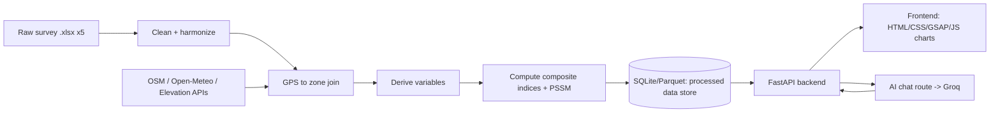

# Workflow — Nainital Tourism Vulnerability Dashboard

This describes how raw survey data becomes the dashboard: pipeline stages, index methodology, the
stress-test simulator, the AI chat route, and the phased build plan. Variable-level detail lives in
`VARIABLES_AND_DATA_SOURCES.md`; this doc is about the *how*.

## 0. Architecture at a glance

- **Batch/offline**: stages A–G run as a data-prep pipeline (Python scripts/notebook), not on
  every request. Output is a small set of processed tables (per-zone scores, per-theme sub-index
  values, respondent-level cleaned records for drill-downs).
- **Online**: FastAPI serves the processed tables + computes the stress-test scenario math on
  demand (cheap, no re-processing of raw survey files at request time) + proxies chat messages to
  Groq with the dashboard's own numbers injected as grounding context.

## 1. Data ingestion

- Read all 5 `.xlsx` files with `pandas`/`openpyxl`.
- Enterprise file has two sheets (`RAW`, `Enterprise_Urban Immersion`) — use the labeled sheet as
  source of truth; `RAW` is the underlying XLSForm choice-coded version, keep only if we need raw
  codes for something the labeled sheet obscures.
- Tag every record with `respondent_type` (enterprise/location/tourist/resident/worker) and keep
  `_uuid`/`_submission_time` for traceability.

## 2. Cleaning & harmonization

- **Coalesce duplicate/versioned columns.** Several questions were re-asked under different labels
  across KoBo form versions (documented per-file in `VARIABLES_AND_DATA_SOURCES.md` §6). Rule: for
  each canonical variable, take `first_non_null` across its known duplicate columns, in a mapping
  table we maintain explicitly (`column_aliases.py` or similar) — never silent regex-guessing.
- **Type coercion**: numeric fields (income, litres, hours, counts) parsed to numbers, blanks/"NA"
  handled as null, not zero.
- **GPS sanity filter**: drop/flag any lat/lon outside a Nainital bounding box (~29.30–29.45°N,
  79.40–79.55°E). At least one Enterprise record has `lat=lon=82` — clearly bad.
- **Ordinal scale normalization**: satisfaction/agreement scales (1–5, Likert-style text) mapped to
  a consistent 0–1 scale, direction-checked (make sure "1=Very Dissatisfied" and "1=Very Difficult"
  both point the same way before any averaging).
- Output: 5 cleaned respondent-level tables, one row per submission, canonical column names.

## 3. Zone assignment (spatial join)

- The 10 Location-survey points are our fixed zone set (v1 — see open question below on naming).
- For every GPS-tagged Enterprise/Resident record, assign it to the **nearest zone point**
  (haversine distance), with a max-distance cutoff (e.g. 500m) — beyond that, keep it in the
  town-wide pool only, not forced into a zone.
- Tourist and Worker surveys are not GPS-tagged — they contribute to **town-wide** scores only, not
  per-zone maps.
- Reverse-geocode the 10 zone points via OSM Nominatim to get human-readable names (e.g. "Mall
  Road", "Tallital", "Naini Lake foreshore"); surface these as editable labels so the user can
  correct them against local knowledge.

## 4. External data enrichment

Per zone (10 points, buffered ~150–300m):
- Overpass API queries for POI counts (parking, dustbins, toilets, drinking water, healthcare,
  hotels, footway length) — cached to disk after first fetch, not re-queried live per dashboard
  load.
- Open-Meteo historical monthly rainfall/temperature for the Nainital centroid — one town-wide
  series, not per-zone.
- Static reference tables (Census population, tourist-arrival stats, GSI landslide flag) loaded
  from a small `reference_data/*.csv` with source+date noted in a header comment.

All external calls happen in the offline pipeline and get cached; the live dashboard never depends
on Overpass/Nominatim being up.

## 5. Variable derivation & index construction

1. Compute every "derived variable" in `VARIABLES_AND_DATA_SOURCES.md` §3 from the cleaned tables.
2. **Normalize**: min-max scale each derived variable to 0–1 across records (or across zones, for
   zone-level variables), clipping outliers at the 1st/99th percentile first so one bad response
   doesn't blow out the scale.
3. **Direction-align**: flip sign (`1 − x`) for variables where higher raw value = better outcome,
   so that in every sub-index, higher = more vulnerable/more pressure, consistently.
4. **Aggregate to sub-indices**: simple weighted mean within each theme (weights start equal,
   stored in one config dict/JSON so they're easy to retune without touching code).
5. **Aggregate to TVI**: weighted mean of the 6 sub-indices (IAI and VEI inverted first), scaled to
   0–100.
6. Compute both **zone-level** and **town-wide** versions of every sub-index and the TVI (town-wide
   = respondent-weighted average across zones + the non-GPS-tagged Tourist/Worker contributions).

All weights and normalization bounds live in one config file — this is the first thing to hand back
to the user/domain reviewers to sanity-check before trusting the numbers.

## 6. Stress/pressure-test simulator

Goal: let the user drag a "peak-season tourist footfall" slider (e.g. baseline → +25% → +50%) and
see WSI, EDPI, and waste-pressure react, using transparent, documented elasticity assumptions
instead of a black-box model:

- Water demand scales ~linearly with visitor count (assumption, tunable constant).
- Waste generation scales ~linearly with visitor count.
- Worker income share from tourism assumed fixed in the short run (structural, doesn't reallocate
  instantly).
- Infrastructure adequacy (parking, toilets, dustbins) is fixed in the short run (no new
  construction), so pressure ratios (visitors per toilet, per dustbin) rise directly with footfall.

Output: a recomputed WSI/WSPI/EDPI/TVI at the chosen footfall multiplier, shown next to the
baseline, so the "stress test" reads as *"if tourism grows by X%, vulnerability moves from A to B"*.
This is a scenario calculator, not a forecast — label it clearly as such in the UI.

## 7. Backend (FastAPI)

Planned routes (v1):
- `GET /api/zones` — zone list with names, coordinates, and current sub-index scores.
- `GET /api/indices/town` — town-wide TVI + 6 sub-indices.
- `GET /api/indices/zone/{zone_id}` — per-zone breakdown.
- `GET /api/variables/{theme}` — underlying derived variables behind a sub-index (for chart drill-down).
- `POST /api/stress-test` — body: `{ footfall_multiplier }` → returns recomputed indices.
- `POST /api/chat` — AI chat route (see §8).
- Data loads from the processed store (SQLite or Parquet) at startup, served from memory —
  no live re-processing of the raw Excel files per request.

## 8. AI chat route

- Provider: **Groq** (key to be supplied later — build behind a small `LLMClient` interface so the
  provider is swappable via `.env`, since the user indicated the key isn't ready yet).
- The route grounds the model with the *current* computed indices (town-wide + selected zone) and
  the variable catalog as system-prompt context, so answers reference this dashboard's real numbers
  instead of generic tourism trivia — e.g. "Why is Naini Lake zone's WSI high?" should be answerable
  from the actual per-zone derived variables, not a guess.
- No raw respondent free-text (open-ended "other, specify" answers) gets sent to the LLM by default
  — only aggregated/derived numbers — to avoid leaking anything that could re-identify a
  respondent, even though the source data is meant to be anonymous.

## 9. Frontend

- Static HTML/CSS/JS (no framework) + GSAP for entrance/scroll animations and transitions between
  dashboard views; a lightweight chart library (Chart.js or D3, to confirm) for gauges/bars/line
  charts; a simple Leaflet or MapLibre map for the zone view (OSM tiles, free, no key).
- Views: (1) Overview — TVI gauge + 6 sub-index bars, town-wide; (2) Zone map — click a zone to see
  its breakdown; (3) Stress-test — slider + before/after comparison; (4) Explorer — theme-level
  charts of the derived variables; (5) AI chat panel.

## 10. Phased implementation plan

1. **Data pipeline**: cleaning/harmonization scripts + zone join + external enrichment → processed
   tables checked into `reference_data/`/`processed/`. Review output numbers before building UI on
   top of them.
2. **Backend**: FastAPI routes serving the processed tables + stress-test math, no AI yet.
3. **Frontend v1**: Overview + zone map + explorer views wired to the backend, static styling.
4. **Stress-test UI**: slider wired to `/api/stress-test`.
5. **GSAP polish pass**: animations, transitions, professional visual pass.
6. **AI chat route**: Groq integration once the key is available, wired into the frontend chat panel.
7. **Review & weight tuning**: revisit index weights/normalization with the user once real numbers
   are visible.

## Open questions for the user (before/while implementing)

- Confirm or correct the auto-generated zone names (Nominatim reverse-geocode guesses).
- Confirm default equal weighting for sub-indices/TVI, or supply preferred weights.
- Confirm the elasticity assumptions in §6 (linear scaling) are acceptable for v1, or refine them.
- Groq API key + preferred model (e.g. `llama-3.3-70b-versatile`) — to be added to `.env` when ready.
