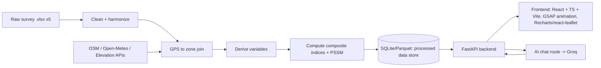

# Workflow — Nainital Tourism Vulnerability Dashboard

This describes how raw survey data becomes the dashboard: pipeline stages, index methodology, the
stress-test simulator, the AI chat route, and the phased build plan. Variable-level detail lives in
`VARIABLES_AND_DATA_SOURCES.md`; cited external metrics/thresholds live in `RESEARCH_BENCHMARKS.md`;
this doc is about the *how*.

## 0. Architecture at a glance

- **Batch/offline**: stages A–G run as a data-prep pipeline (Python scripts/notebook), not on
  every request. Output is a small set of processed tables (per-zone scores, per-theme sub-index
  values, respondent-level cleaned records for drill-downs).
- **Online**: FastAPI serves the processed tables + computes the stress-test scenario math on
  demand (cheap, no re-processing of raw survey files at request time) + proxies chat messages to
  Groq with the dashboard's own numbers injected as grounding context.

## 1. Data ingestion

- Read all 5 `.xlsx` files with `pandas`/`openpyxl`.
- Enterprise file has two sheets (`RAW`, `Enterprise_Urban Immersion`) — use the labeled sheet as
  source of truth; `RAW` is the underlying XLSForm choice-coded version, keep only if we need raw
  codes for something the labeled sheet obscures.
- Tag every record with `respondent_type` (enterprise/location/tourist/resident/worker) and keep
  `_uuid`/`_submission_time` for traceability.

## 2. Cleaning & harmonization — **done**, see `notebooks/01_data_cleaning_eda.ipynb`

- **Coalesce duplicate/versioned columns.** Verified by inspecting non-null counts per candidate
  pair before merging (not blind regex): Kobo splits every Likert question into an always-empty
  label column plus the real numeric answer in the next column (`"(1 Very X – 5 Very Y)"`); a
  handful of questions were genuinely reworded across form revisions with disjoint response counts
  (documented per-file in the notebook and `VARIABLES_AND_DATA_SOURCES.md`). Rule: `coalesce()`
  takes `first_non_null` across a survey-specific, explicitly-listed column group.
- **Drop dead columns**: any column with 0 non-null responses (never-used later form-revision
  fields) is dropped and logged — Enterprise −1 col, Location −27, Tourist −17, Residents −16,
  Workers −12 (see `processed/data_quality_report.csv`).
- **GPS sanity filter**: lat/lon outside a Nainital bounding box (29.30–29.45°N, 79.40–79.55°E) is
  nulled (row kept, coordinates dropped). Caught 9 bad Enterprise points and 19 bad Residents points
  — e.g. at least one Enterprise record had `lat=lon=82`.
- **Ordinal scale normalization**: not yet applied (planned for the index-computation stage, §5) —
  the notebook keeps 1–5 Likert answers as-is and just confirms which column holds the real answer.
- **Known thin variable**: Enterprise's `water_shortage_days_month` / `water_hours_supply` each have
  only 1 non-null response — flagged in the notebook, excluded from index inputs; use
  `water_constraint_limits_ops` / `water_shortage_worse_peak` instead (far higher response counts).
- Output: 5 cleaned respondent-level CSVs in `processed/` (`enterprise_clean.csv`,
  `location_clean.csv`, `tourist_clean.csv`, `residents_clean.csv`, `workers_clean.csv`) plus
  `processed/data_quality_report.csv` summarizing rows/columns in vs. out per survey.

## 3. Zone assignment (spatial join) — **done** (join logic), naming still open

- The 10 Location-survey points are our fixed zone set, currently labeled placeholder `Z01`..`Z10`.
- Every GPS-tagged Enterprise/Resident record is assigned to the **nearest zone point** (haversine
  distance) with a 500m cutoff. Result: 61/157 Enterprise and 143/239 Residents records matched to a
  zone; the rest (mostly outside the 10 audited hotspots) count in the **town-wide** rollup only, not
  forced into a zone.
- Tourist and Worker surveys are not GPS-tagged — they contribute to **town-wide** scores only, not
  per-zone maps.
- **Still open**: reverse-geocode the 10 zone points via OSM Nominatim to get human-readable names
  (e.g. "Mall Road", "Tallital", "Naini Lake foreshore") — not yet run; needs the user to confirm the
  resulting names against local knowledge before they're locked in.

## 4. External data enrichment

Per zone (10 points, buffered ~150–300m):
- Overpass API queries for POI counts (parking, dustbins, toilets, drinking water, healthcare,
  hotels, footway length) — cached to disk after first fetch, not re-queried live per dashboard
  load.
- Open-Meteo historical monthly rainfall/temperature for the Nainital centroid — one town-wide
  series, not per-zone.
- Static reference tables (Census population, tourist-arrival stats, GSI landslide flag) loaded
  from a small `reference_data/*.csv` with source+date noted in a header comment.

All external calls happen in the offline pipeline and get cached; the live dashboard never depends
on Overpass/Nominatim being up.

## 5. Variable derivation & index construction

1. Compute every "derived variable" in `VARIABLES_AND_DATA_SOURCES.md` §3 from the cleaned tables in
   `processed/`.
2. **Normalize**: min-max scale each derived variable to 0–1 across records (or across zones, for
   zone-level variables), clipping outliers at the 1st/99th percentile first so one bad response
   doesn't blow out the scale. Methodology follows the OECD/JRC composite-indicator handbook —
   see `RESEARCH_BENCHMARKS.md` §1.3.
3. **Direction-align**: flip sign (`1 − x`) for variables where higher raw value = better outcome,
   so that in every sub-index, higher = more vulnerable/more pressure, consistently.
4. **Aggregate to sub-indices**: simple weighted mean within each theme (weights start equal,
   stored in one config dict/JSON so they're easy to retune without touching code).
5. **Aggregate to TVI**: weighted mean of the 6 sub-indices (IAI and VEI inverted first), scaled to
   0–100.
6. Compute both **zone-level** and **town-wide** versions of every sub-index and the TVI (town-wide
   = respondent-weighted average across zones + the non-GPS-tagged Tourist/Worker contributions).

All weights and normalization bounds live in one config file — this is the first thing to hand back
to the user/domain reviewers to sanity-check before trusting the numbers.

## 6. Stress/pressure-test simulator

Goal: let the user drag a "peak-season tourist footfall" slider (e.g. baseline → +25% → +50%) and
see WSI, EDPI, and waste-pressure react, using transparent, documented elasticity assumptions
instead of a black-box model. Baseline anchor: Nainital's road capacity is ~3,000 vehicles vs.
3,000–4,000/day actual peak-season inflow (already ~1.0–1.3× capacity) and up to ~50,000 vehicles on
peak summer weekends (~16.7× capacity) — see `RESEARCH_BENCHMARKS.md` §1.1. The slider's "current
peak," "+25%," "+50%" points should be shown against this real anchor, not an arbitrary 0–100% scale.

- Water demand scales ~linearly with visitor count (assumption, tunable constant).
- Waste generation scales ~linearly with visitor count.
- Worker income share from tourism assumed fixed in the short run (structural, doesn't reallocate
  instantly).
- Infrastructure adequacy (parking, toilets, dustbins) is fixed in the short run (no new
  construction), so pressure ratios (visitors per toilet, per dustbin) rise directly with footfall.

Output: a recomputed WSI/WSPI/EDPI/TVI at the chosen footfall multiplier, shown next to the
baseline, so the "stress test" reads as *"if tourism grows by X%, vulnerability moves from A to B"*.
This is a scenario calculator, not a forecast — label it clearly as such in the UI.

## 7. Backend (FastAPI)

Planned routes (v1):
- `GET /api/zones` — zone list with names, coordinates, and current sub-index scores.
- `GET /api/indices/town` — town-wide TVI + 6 sub-indices.
- `GET /api/indices/zone/{zone_id}` — per-zone breakdown.
- `GET /api/variables/{theme}` — underlying derived variables behind a sub-index (for chart drill-down).
- `POST /api/stress-test` — body: `{ footfall_multiplier }` → returns recomputed indices.
- `POST /api/chat` — AI chat route (see §8).
- Data loads from the processed store (SQLite or Parquet) at startup, served from memory —
  no live re-processing of the raw Excel files per request.

## 8. PahadiBot (AI chat route)

The dashboard's assistant is named **PahadiBot** ("pahadi" = of the hills, fitting for a Nainital
tool). Frontend stub already built: `frontend/src/components/PahadiBot/PahadiBotLauncher.tsx`, a
fixed launcher button + panel that currently states plainly that it isn't connected yet.

- Provider: **Groq** (key to be supplied later, build behind a small `LLMClient` interface so the
  provider is swappable via `.env`, since the user indicated the key isn't ready yet).
- The route grounds the model with the *current* computed indices (town-wide + selected zone) and
  the variable catalog as system-prompt context, so answers reference this dashboard's real numbers
  instead of generic tourism trivia. For example "Why is Naini Lake zone's WSI high?" should be
  answerable from the actual per-zone derived variables, not a guess.
- No raw respondent free-text (open-ended "other, specify" answers) gets sent to the LLM by default,
  only aggregated/derived numbers, to avoid leaking anything that could re-identify a respondent,
  even though the source data is meant to be anonymous.
- Route: `POST /api/chat`, called from `PahadiBotLauncher`'s panel once built out into a real chat
  UI (message list + input), replacing the current static placeholder text.

## 9. Frontend

- **React + TypeScript, built with Vite** — a client-side SPA that talks to the FastAPI backend over
  JSON, no SSR. GSAP still drives entrance/scroll animations and view transitions (used via
  `useEffect`/`useLayoutEffect` + refs, GSAP's React integration pattern, not `react-gsap` wrapper
  packages — direct GSAP API keeps it simple and matches GSAP's own recommended React usage).
- Charting: a React-friendly chart library (Recharts or visx, to confirm) for gauges/bars/line
  charts. Mapping: `react-leaflet` (OSM tiles, free, no key) for the zone view.
- Structure: component-per-view, a small typed API client (`api/`) wrapping the FastAPI routes below,
  shared TypeScript types for the index/zone/variable response shapes (mirrors the Pydantic models on
  the backend, kept in sync manually or generated from the OpenAPI schema — to decide when we build
  it).
- Dev flow: Vite dev server proxies `/api/*` to the local FastAPI instance; production build is a
  static `dist/` folder, served either by FastAPI's `StaticFiles` or a separate static host — to
  confirm at deploy time.
- Pages: (1) **Landing** (`/`) — the front page: hero, flowing-menu nav into the dashboard, photo
  gallery, methodology stats. (2) **Dashboard Dome** (`/dashboard`) — a single merged instrument
  panel, not three separate routes. An iOS-style pill tab bar swaps three views in place: Overview
  (TVI gauge + 6 sub-index bars, town-wide), Zone Map (click a zone to see its breakdown), and
  Stress Test (slider + before/after comparison). Tab state lives in the URL as `?tab=`, so the
  landing page's flowing-menu can deep-link straight into a given view. PahadiBot (see §8) is a
  floating panel available from both pages, not a tab. Room is reserved for a possible third page
  (another theme) later; the Explorer/per-pillar-drilldown idea folded into Overview's expandable
  component rows rather than becoming its own view.

### 9.1 Visual language (locked in, applies to every future screen)

Set with the landing page (`frontend/src/App.tsx`, `frontend/src/styles/`), documented here so later
work stays consistent instead of drifting toward generic AI-tool defaults:

- **Palette**: warm white / grey / one terracotta orange only (`frontend/src/styles/tokens.css`).
  No purple, no pastel rainbow, no neon, no dark mode. Gradients only ever blend two colors already
  in the palette, and stay subtle.
- **Type**: Fraunces (display serif) + Instrument Sans (body) + JetBrains Mono (labels, numerals,
  UI chrome). Deliberately not Inter/Poppins/Manrope/DM Sans.
- **Structure**: near-zero border radius, hard-offset "sticker" shadows (never blurred/soft), visible
  hairline borders between sections. A bit of brutalism: exposed grid, mono index numbers, blocky
  panels.
- **No**: emoji, skeleton loaders (use the mono `Loading` component / terminal-style dot indicator
  instead), hover animation on things that aren't actually interactive, sparkle icons, bento grids,
  color-stripe accents, em dashes in any UI copy.
- **Imagery**: real, properly licensed photography only (Wikimedia Commons CC BY-SA 4.0 so far, see
  `frontend/src/assets/art/ATTRIBUTIONS.md`), processed into duotone/tritone art in the palette
  (`process_art.py`-style pipeline: autocontrast grayscale + `ImageOps.colorize` + light grain).
  Reused as the flowing-menu strip, the dome gallery, and the pixel-transition hero reveal.
- **Signature components** (`frontend/src/components/`): `Cursor` (crosshair, viewfinder-bracket
  hover state, no lag), `PixelTransition` (staggered square-grid reveal, also used as the full-page
  route wipe between Landing and the Dome), `FlowingMenu` (marquee nav row with velocity-skew),
  `DomeGallery` (drag-to-rotate 3D photo dome).
- **Dashboard Dome pill tab bar** (`frontend/src/pages/Dashboard.tsx`): the one deliberately rounded
  shape in the system, an iOS-style segmented control, kept brutalist rather than soft — hard ink
  border, hard offset shadow, a solid rust thumb re-parented between tabs with GSAP Flip (the same
  pattern the header's active-link marker uses). This is a scoped exception to the near-zero-radius
  rule, not a relaxation of it elsewhere.

## 10. Phased implementation plan

1. **Data pipeline** — *cleaning/harmonization + zone join done* (`notebooks/01_data_cleaning_eda.ipynb`
   → `processed/*.csv`); *external enrichment (OSM/Open-Meteo/reference tables) still open*. Review
   the notebook's output/open-items list before building UI on top of it.
2. **Backend**: FastAPI routes serving the processed tables + stress-test math, no AI yet.
3. **Frontend v1** — *design system, landing page, and backend wiring done* (`frontend/`,
   Vite/React/TS): palette, type, the custom crosshair cursor, pixel-transition reveal,
   flowing-menu nav, and dome photo gallery are built into the landing page with real (cited)
   Nainital photography processed into duotone/tritone art. The data-driven views (Overview, Zone
   Map, Stress Test) are live, reading the FastAPI backend (step 2).
4. **Dashboard Dome merge** — *done*: the three data views were consolidated from separate routes
   into one page (`frontend/src/pages/Dashboard.tsx`), navigated with an iOS-style pill tab bar
   instead of a page change, per the "2-3 page, Tableau-style" direction — a presentable single
   instrument panel rather than a multi-page app.
5. **GSAP polish pass** — *done*: entrance/scroll animations, the scroll-drawn Nainital SVG scene,
   the looping photo strip, magnetic controls, and the route/tab transitions are all built.
6. **AI chat route** — *frontend done*: the PahadiBot panel is wired to `/api/chat` and degrades
   honestly (shows raw grounding context, flags itself as unconfigured) with no key set. Only the
   Groq key itself is still pending from the user.
7. **Review & weight tuning**: revisit index weights/normalization with the user once real numbers
   are visible; confirm the ten zone names with local reviewers.

## Open questions for the user (before/while implementing)

- Confirm or correct the auto-generated zone names (Nominatim reverse-geocode guesses).
- Confirm default equal weighting for sub-indices/TVI, or supply preferred weights.
- Confirm the elasticity assumptions in §6 (linear scaling) are acceptable for v1, or refine them.
- Groq API key + preferred model (e.g. `llama-3.3-70b-versatile`) — to be added to `.env` when ready.
