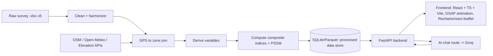

# Workflow — Nainital Tourism Vulnerability Dashboard

This describes how raw survey data becomes the dashboard: pipeline stages, index methodology, the
stress-test simulator, the AI chat route, and the phased build plan. Variable-level detail lives in
`VARIABLES_AND_DATA_SOURCES.md`; cited external metrics/thresholds live in `RESEARCH_BENCHMARKS.md`;
this doc is about the *how*.

## 0. Architecture at a glance

- **Batch/offline**: stages A–G run as a data-prep pipeline (Python scripts/notebook), not on
  every request. Output is a small set of processed tables (per-zone scores, per-theme sub-index
  values, respondent-level cleaned records for drill-downs).
- **Online**: FastAPI serves the processed tables + computes the stress-test scenario math on
  demand (cheap, no re-processing of raw survey files at request time) + proxies chat messages to
  Groq with the dashboard's own numbers injected as grounding context.

## 1. Data ingestion

- Read all 5 `.xlsx` files with `pandas`/`openpyxl`.
- Enterprise file has two sheets (`RAW`, `Enterprise_Urban Immersion`) — use the labeled sheet as
  source of truth; `RAW` is the underlying XLSForm choice-coded version, keep only if we need raw
  codes for something the labeled sheet obscures.
- Tag every record with `respondent_type` (enterprise/location/tourist/resident/worker) and keep
  `_uuid`/`_submission_time` for traceability.

## 2. Cleaning & harmonization — **done**, see `notebooks/01_data_cleaning_eda.ipynb`

- **Coalesce duplicate/versioned columns.** Verified by inspecting non-null counts per candidate
  pair before merging (not blind regex): Kobo splits every Likert question into an always-empty
  label column plus the real numeric answer in the next column (`"(1 Very X – 5 Very Y)"`); a
  handful of questions were genuinely reworded across form revisions with disjoint response counts
  (documented per-file in the notebook and `VARIABLES_AND_DATA_SOURCES.md`). Rule: `coalesce()`
  takes `first_non_null` across a survey-specific, explicitly-listed column group.
- **Drop dead columns**: any column with 0 non-null responses (never-used later form-revision
  fields) is dropped and logged — Enterprise −1 col, Location −27, Tourist −17, Residents −16,
  Workers −12 (see `processed/data_quality_report.csv`).
- **GPS sanity filter**: lat/lon outside a Nainital bounding box (29.30–29.45°N, 79.40–79.55°E) is
  nulled (row kept, coordinates dropped). Caught 9 bad Enterprise points and 19 bad Residents points
  — e.g. at least one Enterprise record had `lat=lon=82`.
- **Ordinal scale normalization**: not yet applied (planned for the index-computation stage, §5) —
  the notebook keeps 1–5 Likert answers as-is and just confirms which column holds the real answer.
- **Known thin variable**: Enterprise's `water_shortage_days_month` / `water_hours_supply` each have
  only 1 non-null response — flagged in the notebook, excluded from index inputs; use
  `water_constraint_limits_ops` / `water_shortage_worse_peak` instead (far higher response counts).
- Output: 5 cleaned respondent-level CSVs in `processed/` (`enterprise_clean.csv`,
  `location_clean.csv`, `tourist_clean.csv`, `residents_clean.csv`, `workers_clean.csv`) plus
  `processed/data_quality_report.csv` summarizing rows/columns in vs. out per survey.

## 3. Zone assignment (spatial join) — **done** (join logic), naming still open

- The Location survey has 10 rows (`Z01`..`Z10`), but `Z01` and `Z02` are ~50m apart — a
  duplicate/erroneous site submission, not two distinct locations (confirmed by the survey team:
  only 9 real sites were surveyed). `backend/app/data_loader.py`'s `EXCLUDED_ZONES` filters `Z02`
  out at load time (not hand-edited into the notebook's generated CSV, so the exclusion survives a
  re-run of `processed/location_clean.csv`), leaving **9 zones**: `Z01`, `Z03`-`Z10`.
- Every GPS-tagged Enterprise/Resident record is assigned to the **nearest zone point** (haversine
  distance) with a 500m cutoff. Result: 61/157 Enterprise and 143/239 Residents records matched to a
  zone; the rest (mostly outside the 9 audited hotspots) count in the **town-wide** rollup only, not
  forced into a zone. A handful were nearest to the now-excluded `Z02` -- they still count in the
  town-wide rollup, they just never surface under a zone-level query.
- Tourist and Worker surveys are not GPS-tagged — they contribute to **town-wide** scores only, not
  per-zone maps.
- **Still open**: reverse-geocode the 9 zone points via OSM Nominatim to get human-readable names
  (e.g. "Mall Road", "Tallital", "Naini Lake foreshore") — not yet run; needs the user to confirm the
  resulting names against local knowledge before they're locked in.

## 4. External data enrichment

Per zone (9 points, buffered ~150–300m):
- Overpass API queries for POI counts (parking, dustbins, toilets, drinking water, healthcare,
  hotels, footway length) — cached to disk after first fetch, not re-queried live per dashboard
  load.
- Open-Meteo historical monthly rainfall/temperature for the Nainital centroid — one town-wide
  series, not per-zone.
- Static reference tables (Census population, tourist-arrival stats, GSI landslide flag) loaded
  from a small `reference_data/*.csv` with source+date noted in a header comment.

All external calls happen in the offline pipeline and get cached; the live dashboard never depends
on Overpass/Nominatim being up.

## 5. Variable derivation & index construction

1. Compute every "derived variable" in `VARIABLES_AND_DATA_SOURCES.md` §3 from the cleaned tables in
   `processed/`.
2. **Normalize**: min-max scale each derived variable to 0–1 across records (or across zones, for
   zone-level variables), clipping outliers at the 1st/99th percentile first so one bad response
   doesn't blow out the scale. Methodology follows the OECD/JRC composite-indicator handbook —
   see `RESEARCH_BENCHMARKS.md` §1.3.
3. **Direction-align**: flip sign (`1 − x`) for variables where higher raw value = better outcome,
   so that in every sub-index, higher = more vulnerable/more pressure, consistently.
4. **Aggregate to sub-indices**: simple weighted mean within each theme (weights start equal,
   stored in one config dict/JSON so they're easy to retune without touching code).
5. **Aggregate to TVI**: weighted mean of the 6 sub-indices (IAI and VEI inverted first), scaled to
   0–100.
6. Compute both **zone-level** and **town-wide** versions of every sub-index and the TVI (town-wide
   = respondent-weighted average across zones + the non-GPS-tagged Tourist/Worker contributions).

All weights and normalization bounds live in one config file — this is the first thing to hand back
to the user/domain reviewers to sanity-check before trusting the numbers.

### 5.1 Dashboard insights (beyond the 6 pillars) — **done**, `backend/app/insights.py`

Four cross-cutting composites, all town-wide only, all reusing already-computed values above (no
new raw aggregation): the **Sustainability Triad** (the 6 pillars regrouped into Economic/Social/
Environmental, Elkington 1997), the **Stakeholder Pressure Matrix** (which respondent group feels
the most pressure on which pillar — falls out of `THEME_COMPONENTS`' existing survey tagging for
free), the **Seasonality Amplification Index** (an empirical peak-vs-off-season signal, distinct
from the stress test below, which is a hypothetical scenario), and the **Host-Visitor Perception
Gap** (implements the Doxey's Irridex banding `RESEARCH_BENCHMARKS.md` §2.3 describes). Full
formulas, normalization, and citations: `VARIABLES_AND_DATA_SOURCES.md` §4.1, and interactively
per-indicator on the landing page's Data & Methodology section (`frontend/src/pages/methodologyContent.ts`).

### 5.2 E-S-AC framework and Resident Attitudes/SET — **done**

Two more, prompted by a user-supplied workbook (`Nainital_Tourism_Vulnerability_Derived_Variables.xlsx`)
and a pasted research narrative:

- **E-S-AC framework** (`backend/app/framework_esac.py`, computed but not currently surfaced as its own dashboard tab): the
  Exposure/Sensitivity/Adaptive Capacity structure `RESEARCH_BENCHMARKS.md` §4 (Shimla study) had
  flagged as a possible v2 restructuring, now built as a second, complementary lens next to the
  6-pillar TVI, reimplemented from `processed/*.csv` via this pipeline's own `derive_*` outputs.
  Several of the source workbook's named sub-variables have no isolated equivalent here and are
  substituted with the nearest available column instead -- every substitution is documented in
  `VARIABLES_AND_DATA_SOURCES.md` §4.2 and in the module's own docstrings.
- **Resident Attitudes & Social Exchange Theory** (`backend/app/resident_attitudes.py`, dashboard
  tab "Attitudes"): tests whether tourism-dependent residents report less irritation than
  non-dependent ones, across the same 3 components SCPI already uses (Economic/Social/Environmental,
  partitioned), using a real Mann-Whitney U + rank-biserial effect size on the actual 239 residents
  (`scipy`, newly added to `backend/requirements.txt`). The pasted narrative's exact figures
  (p=0.093, r=-0.016) came from a pillar-item bundle and stats run this pipeline can't reproduce, so
  this recomputes the same *kind* of analysis fresh rather than displaying those numbers -- per the
  user's own choice when asked. `VARIABLES_AND_DATA_SOURCES.md` §4.3, `RESEARCH_BENCHMARKS.md` §2.7.

### 5.3 Trends (Dashboard tab) -- **done**

Built first as a separate, single long report page at `/trends` -- the user explicitly asked for
"1 more page" that time, distinct from the Dashboard's instrument-panel tabs -- then, per a
follow-up request, folded in as a sixth Dashboard tab. Per a further follow-up, the standalone
`/trends` route and its nav link were dropped entirely: the content only ever needed to live in one
place, and the Dashboard tab already had its own intro lede, so the separate page's header was pure
duplication. `frontend/src/pages/dashboard/TrendsTab.tsx` is now the only home for it: KPIs, a
scenario-trend line chart, a six-pillar bar chart, a stakeholder radar, and a dynamic variable
explorer, using the Dashboard's shared header.

Two of its four data sources are new re-readings of already-computed values, not new derivations:
`stress_test.compute_scenario_trend()` (`backend/app/stress_test.py`) just runs the existing
`run_stress_test()` across the 4 footfall presets and returns the town-wide TVI at each; a real
tourism-arrival time series isn't available yet (`VARIABLES_AND_DATA_SOURCES.md` §5 still flags
that as unfetched external data), so this substitutes honestly for a "trend" rather than fabricating
2000-2024 history. `insights.compute_sustainability_by_stakeholder()` re-buckets the existing
Stakeholder Pressure Matrix into the same Economic/Social/Environmental grouping the Sustainability
Triad uses, per survey instead of town-wide -- Workers/Tourist only populate 1-2 of the 3 buckets,
so the frontend radar only plots groups with all three present (in practice: Enterprise vs.
Residents, a different comparison than the Resident Attitudes tab's tourism-dependency split).

The variable explorer reuses the existing `GET /api/variables/{theme}` route (no new backend) --
a theme dropdown just re-fetches and re-renders `BarChartGeneric`. Three new hand-built SVG chart
components (`frontend/src/components/IndexViz/`): `LineChart` (category-spaced, not a continuous
timeline, with a getTotalLength()-driven draw-on animation), `RadarChart` (multi-series, series told
apart by stroke style and marker shape rather than new hues, same convention as `CoxcombChart`'s
textures), and `BarChartGeneric` (the same `.subindex-bar` row visual `SubIndexBar` uses,
generalized to arbitrary labeled data so it can re-render on a dropdown change).

### 5.4 "Who we surveyed" -- **done**, `backend/app/demographics.py`

Per a follow-up request, the Overview tab got a second grid of chart-only panels below the six
pillars and the two cross-cutting insights, this time surfacing raw respondent composition instead
of any derived index: plain `value_counts()` on real survey questions, not new indicators.
`compute_demographics()` reads straight from the already-loaded `processed/*.csv` tables (via
`colfind.find_col`, the same fuzzy column-matching `derive.py` already uses) and returns percentage
breakdowns + raw counts, no normalization or weighting involved. New route
`GET /api/insights/demographics`.

Four panels, all `BarChartGeneric` (no new chart component needed): **Who we surveyed** (the
Tourist/Resident/Worker/Enterprise split, as a share of the 1,019 people surveyed, plus the 9 zones
site-audited separately), **Tourist profile** (age group, gender), **Visit pattern** (first-time vs.
repeat visitor, accommodation type), and **Livelihoods** (enterprise type, worker sector -- the
worker-sector option text is shortened to drop its parenthetical example list, e.g. "Hospitality
(Hotels, Restaurants, Resorts etc)" -> "Hospitality", for chart-label readability only; the full
text is unchanged in the raw data).

## 6. Stress/pressure-test simulator

Goal: let the user drag a "peak-season tourist footfall" slider (e.g. baseline → +25% → +50%) and
see WSI, EDPI, and waste-pressure react, using transparent, documented elasticity assumptions
instead of a black-box model. Baseline anchor: Nainital's road capacity is ~3,000 vehicles vs.
3,000–4,000/day actual peak-season inflow (already ~1.0–1.3× capacity) and up to ~50,000 vehicles on
peak summer weekends (~16.7× capacity) — see `RESEARCH_BENCHMARKS.md` §1.1. The slider's "current
peak," "+25%," "+50%" points should be shown against this real anchor, not an arbitrary 0–100% scale.

- Water demand scales ~linearly with visitor count (assumption, tunable constant).
- Waste generation scales ~linearly with visitor count.
- Worker income share from tourism assumed fixed in the short run (structural, doesn't reallocate
  instantly).
- Infrastructure adequacy (parking, toilets, dustbins) is fixed in the short run (no new
  construction), so pressure ratios (visitors per toilet, per dustbin) rise directly with footfall.

Output: a recomputed WSI/WSPI/EDPI/TVI at the chosen footfall multiplier, shown next to the
baseline, so the "stress test" reads as *"if tourism grows by X%, vulnerability moves from A to B"*.
This is a scenario calculator, not a forecast — label it clearly as such in the UI.

## 7. Backend (FastAPI)

Planned routes (v1):
- `GET /api/zones` — zone list with names, coordinates, and current sub-index scores.
- `GET /api/indices/town` — town-wide TVI + 6 sub-indices.
- `GET /api/indices/zone/{zone_id}` — per-zone breakdown.
- `GET /api/variables/{theme}` — underlying derived variables behind a sub-index (for chart drill-down).
- `GET /api/insights/town` — the Sustainability Triad, Stakeholder Pressure Matrix, Seasonality
  Amplification Index, and Host-Visitor Perception Gap (§5.1). Town-wide only.
- `GET /api/insights/esac` — the E-S-AC framework, town-wide + per zone (§5.2).
- `GET /api/insights/resident-attitudes` — the Resident Attitudes/SET group comparison (§5.2).
- `GET /api/insights/scenario-trend` — the Stress Test's own footfall presets re-read as a trend,
  used by the Trends page's line chart (§5.3).
- `GET /api/insights/sustainability-by-stakeholder` — the Sustainability Triad re-bucketed per
  survey group, used by the Trends page's radar chart (§5.3).
- `POST /api/stress-test` — body: `{ footfall_multiplier }` → returns recomputed indices.
- `POST /api/chat` — AI chat route (see §8).
- Data loads from the processed store (SQLite or Parquet) at startup, served from memory —
  no live re-processing of the raw Excel files per request.

## 8. PahadiBot (AI chat route)

The dashboard's assistant is named **PahadiBot** ("pahadi" = of the hills, fitting for a Nainital
tool). Frontend stub already built: `frontend/src/components/PahadiBot/PahadiBotLauncher.tsx`, a
fixed launcher button + panel that currently states plainly that it isn't connected yet.

- Provider: **Groq** -- *done*: three keys supplied, configured as a fallback pool
  (`DASHBOARD_GROQ_API_KEYS`, comma-separated, in the repo-root `.env`). `GroqLLMClient`
  (`backend/app/llm.py`) tries each key in order and only falls back to the next one on a 429 (rate
  limit) response; any other error (bad request, invalid key, etc.) is raised immediately rather
  than silently masked. Built behind a small `LLMClient` interface so the provider itself stays
  swappable. Model: `openai/gpt-oss-120b` -- the originally planned `llama-3.3-70b-versatile` has
  since been decommissioned from Groq's lineup; confirmed the current one against `GET
  /openai/v1/models` and a live test call before wiring it in.
- The route grounds the model with the *current* computed indices (town-wide + selected zone) and
  the variable catalog as system-prompt context, so answers reference this dashboard's real numbers
  instead of generic tourism trivia. For example "Why is Naini Lake zone's WSI high?" should be
  answerable from the actual per-zone derived variables, not a guess.
- No raw respondent free-text (open-ended "other, specify" answers) gets sent to the LLM by default,
  only aggregated/derived numbers, to avoid leaking anything that could re-identify a respondent,
  even though the source data is meant to be anonymous.
- Route: `POST /api/chat`, called from `PahadiBotLauncher`'s panel once built out into a real chat
  UI (message list + input), replacing the current static placeholder text.

## 9. Frontend

- **React + TypeScript, built with Vite** — a client-side SPA that talks to the FastAPI backend over
  JSON, no SSR. GSAP still drives entrance/scroll animations and view transitions (used via
  `useEffect`/`useLayoutEffect` + refs, GSAP's React integration pattern, not `react-gsap` wrapper
  packages — direct GSAP API keeps it simple and matches GSAP's own recommended React usage).
- Charting: a React-friendly chart library (Recharts or visx, to confirm) for gauges/bars/line
  charts. Mapping: `react-leaflet` (OSM tiles, free, no key) for the zone view.
- Structure: component-per-view, a small typed API client (`api/`) wrapping the FastAPI routes below,
  shared TypeScript types for the index/zone/variable response shapes (mirrors the Pydantic models on
  the backend, kept in sync manually or generated from the OpenAPI schema — to decide when we build
  it).
- Dev flow: Vite dev server proxies `/api/*` to the local FastAPI instance; production build is a
  static `dist/` folder, served either by FastAPI's `StaticFiles` or a separate static host — to
  confirm at deploy time.
- Pages: (1) **Landing** (`/`) — the front page: hero, flowing-menu nav into the dashboard, photo
  gallery, and the **Data & Methodology** section (`#data`), which ends with an interactive
  per-indicator picker (`frontend/src/pages/MethodologyTab.tsx`, a `size="small"` `PillTabs`
  instance) covering all 13 indicators — definition, source components, normalization method,
  formula, and citations, one at a time (`pages/methodologyContent.ts`). Deliberately kept off the
  Dashboard itself, so the dashboard stays focused on the live numbers and the reference material
  lives where a reader would look for it first. (2) **Dashboard** (`/dashboard`) — a single merged
  instrument panel, not six separate routes. An iOS-style pill tab bar (`components/PillTabs/`,
  shared with the Methodology picker above) swaps six views in place, in this order: **Overview**
  (TVI gauge + 6 sub-index bars, the KPI strip, the Sustainability Triad Coxcomb, and the
  Stakeholder Pressure Matrix — §5.1), **Zone Map** (click a zone to see its breakdown), **E-S-AC**
  (the second Exposure/Sensitivity/Adaptive Capacity vulnerability lens, town-wide + per zone —
  §5.2), **Attitudes** (the Resident Attitudes/Social Exchange Theory group comparison — §5.2),
  **Trends** (the report view described below — §5.3), and **Stress Test** (slider + before/after
  comparison, deliberately last now that the dashboard has more to see first). Tab state lives in
  the URL as `?tab=`, so the landing page's flowing-menu can deep-link straight into a given view.
  Trends briefly also had its own standalone route (`/trends`) with a duplicate header, but that
  was dropped -- it only ever needed to live in the Dashboard (§5.3). PahadiBot (see §8) is a
  floating panel available from every page, not a tab.

### 9.1 Visual language (locked in, applies to every future screen)

Set with the landing page (`frontend/src/App.tsx`, `frontend/src/styles/`), documented here so later
work stays consistent instead of drifting toward generic AI-tool defaults:

- **Palette**: warm white / grey / one terracotta orange only (`frontend/src/styles/tokens.css`).
  No purple, no pastel rainbow, no neon, no dark mode. Gradients only ever blend two colors already
  in the palette, and stay subtle.
- **Type**: Fraunces (display serif) + Instrument Sans (body) + JetBrains Mono (labels, numerals,
  UI chrome). Deliberately not Inter/Poppins/Manrope/DM Sans.
- **Structure**: near-zero border radius, hard-offset "sticker" shadows (never blurred/soft), visible
  hairline borders between sections. A bit of brutalism: exposed grid, mono index numbers, blocky
  panels.
- **No**: emoji, skeleton loaders (use the mono `Loading` component / terminal-style dot indicator
  instead), hover animation on things that aren't actually interactive, sparkle icons, bento grids,
  color-stripe accents, em dashes in any UI copy.
- **Imagery**: real, properly licensed photography only (Wikimedia Commons CC BY-SA 4.0 so far, see
  `frontend/src/assets/art/ATTRIBUTIONS.md`), processed into duotone/tritone art in the palette
  (`process_art.py`-style pipeline: autocontrast grayscale + `ImageOps.colorize` + light grain).
  Reused as the flowing-menu strip, the dome gallery, and the pixel-transition hero reveal.
- **Signature components** (`frontend/src/components/`): `Cursor` (crosshair, viewfinder-bracket
  hover state, no lag), `PixelTransition` (staggered square-grid reveal, also used as the full-page
  route wipe between Landing and the Dome), `FlowingMenu` (marquee nav row with velocity-skew),
  `DomeGallery` (drag-to-rotate 3D photo dome).
- **Pill tab bar** (`frontend/src/components/PillTabs/`): the one deliberately rounded shape in the
  system, an iOS-style segmented control, kept brutalist rather than soft — hard ink border, hard
  offset shadow, a solid rust thumb re-parented between tabs with GSAP Flip (the same pattern the
  header's active-link marker uses). A scoped exception to the near-zero-radius rule, not a
  relaxation of it elsewhere. Extracted as a generic `{ tabs, active, onSelect }` component so both
  the Dashboard's top-level nav and the landing page's Methodology picker (`size="small"`)
  share one implementation.
- **Coxcomb / stakeholder-matrix charts** (`frontend/src/components/IndexViz/`): `CoxcombChart` is a
  hand-built SVG Nightingale rose — three categories told apart by *texture* (solid rust, a
  diagonal-hatch rust pattern, an outline-only wedge), not by introducing new hues, staying inside
  the warm-white/grey/orange rule. `StakeholderMatrixGrid` is a hard-bordered grid, not a soft
  gradient heatmap, cell fill = rust `color-mix` opacity (the same technique the zone-map markers
  already use).

## 10. Phased implementation plan

1. **Data pipeline** — *cleaning/harmonization + zone join done* (`notebooks/01_data_cleaning_eda.ipynb`
   → `processed/*.csv`); *external enrichment (OSM/Open-Meteo/reference tables) still open*. Review
   the notebook's output/open-items list before building UI on top of it.
2. **Backend**: FastAPI routes serving the processed tables + stress-test math, no AI yet.
3. **Frontend v1** — *design system, landing page, and backend wiring done* (`frontend/`,
   Vite/React/TS): palette, type, the custom crosshair cursor, pixel-transition reveal,
   flowing-menu nav, and dome photo gallery are built into the landing page with real (cited)
   Nainital photography processed into duotone/tritone art. The data-driven views (Overview, Zone
   Map, Stress Test) are live, reading the FastAPI backend (step 2).
4. **Dashboard merge** — *done*: the data views were consolidated from separate routes into one
   page (`frontend/src/pages/Dashboard.tsx`, originally named "Dashboard Dome" -- shortened to just
   "Dashboard" per the user's later request), navigated with an iOS-style pill tab bar instead of a
   page change, per the "2-3 page, Tableau-style" direction. Later extended (still *done*) with the
   Sustainability Triad, Stakeholder Pressure Matrix, Seasonality Amplification Index, and
   Host-Visitor Perception Gap in Overview, and reordered to Overview → Zone Map → Stress Test
   (last). The per-indicator Methodology picker (§5.1) was built as part of this pass but moved to
   the landing page's Data & Methodology section rather than staying a Dashboard tab, so the
   dashboard itself stays focused on the live numbers.
5. **GSAP polish pass** — *done*: entrance/scroll animations, the scroll-drawn Nainital SVG scene,
   the looping photo strip, magnetic controls, and the route/tab transitions are all built.
6. **AI chat route** — *done*: the PahadiBot panel is wired to `/api/chat`, degrades honestly (shows
   raw grounding context, flags itself as unconfigured) with no key set, and now has three real Groq
   keys configured as a fallback pool (§8) -- confirmed working end-to-end with a live test call.
7. **E-S-AC framework + Resident Attitudes/SET** — *done* (§5.2): two more tabs, prompted by a
   user-supplied workbook and a pasted research narrative. Per the user's own choice when asked:
   both became Dashboard tabs (not a separate page), and the Resident Attitudes numbers are
   freshly computed from real data rather than reproducing the pasted figures.
8. **Trends page** — *done* (§5.3): first built as a separate, single long report page -- the user
   explicitly asked for "1 more page" that time, not more Dome tabs. KPIs, a scenario-trend line
   chart, a pillar bar chart, a stakeholder radar, and a dynamic variable explorer, all built from data
   already computed elsewhere in the pipeline.
9. **Trends folded into the Dashboard, "Dome" dropped from the name** — *done*: per a follow-up
   request, the Trends content became a sixth Dashboard tab too (`TrendsTab.tsx` extracted so both
   the tab and the standalone `/trends` page could share it), and every "Dashboard Dome" reference
   across the UI and docs was renamed to plain "Dashboard."
10. **Standalone `/trends` route removed** — *done*: per a further follow-up, the separate `/trends`
    page and its header/nav link were dropped -- Trends only ever needed to live as a Dashboard tab,
    and the standalone page's own header (eyebrow/heading/lede) was pure duplication of the tab's
    lede. Also dropped, same pass: the "read NN%" scroll-position readout in the header's instrument
    rail (`components/SiteHeader/SiteHeader.tsx`), which the user found unnecessary chrome.
11. **"Who we surveyed" charts added to Overview** — *done* (§5.4): per a follow-up asking for more
    Overview content, "explained only via charts," sourced from the actual survey data rather than
    another derived index -- four new chart panels of raw respondent-composition breakdowns
    (`backend/app/demographics.py`), plus a fix for the Stakeholder Pressure Matrix's column-header
    overlap bug (grid items need `min-width: 0` to wrap instead of overflowing past their track).
12. **Review & weight tuning**: revisit index weights/normalization with the user once real numbers
    are visible; confirm the nine zone names with local reviewers.

## Open questions for the user (before/while implementing)

- Confirm or correct the auto-generated zone names (Nominatim reverse-geocode guesses).
- Confirm default equal weighting for sub-indices/TVI, or supply preferred weights.
- Confirm the elasticity assumptions in §6 (linear scaling) are acceptable for v1, or refine them.
- Confirm the Sustainability Triad's Economic/Social/Environmental grouping (§5.1) — infrastructure
  adequacy was placed under Environmental (physical/ecological carrying capacity), not a separate
  institutional pillar; corroborated by the GSTC crosswalk in `RESEARCH_BENCHMARKS.md` §2.4 but it's
  this project's own interpretive choice, not a fixed standard.
- Confirm the Seasonality Amplification Index's 5 components (§5.1) and the Host-Visitor Perception
  Gap's Doxey-stage banding thresholds (`RESEARCH_BENCHMARKS.md` §2.3) read as reasonable, since both
  are this project's own aggregation choices, not lifted from an external validated formula.
- Confirm the E-S-AC framework's substitutions (§5.2, listed in full in
  `VARIABLES_AND_DATA_SOURCES.md` §4.2) are acceptable stand-ins for the source workbook's original
  variables, given this pipeline doesn't derive several of them separately today.
- Confirm the Resident Attitudes/SET pillar definitions (§5.2, §4.3) — this project's own 3-way split
  of SCPI's existing components, not the exact bundle behind the pasted narrative's p=0.093/r=-0.016
  figures, which this pipeline can't reproduce.
- ~~Groq API key~~ — *resolved*: three keys added as a fallback pool, `openai/gpt-oss-120b` (§8).
